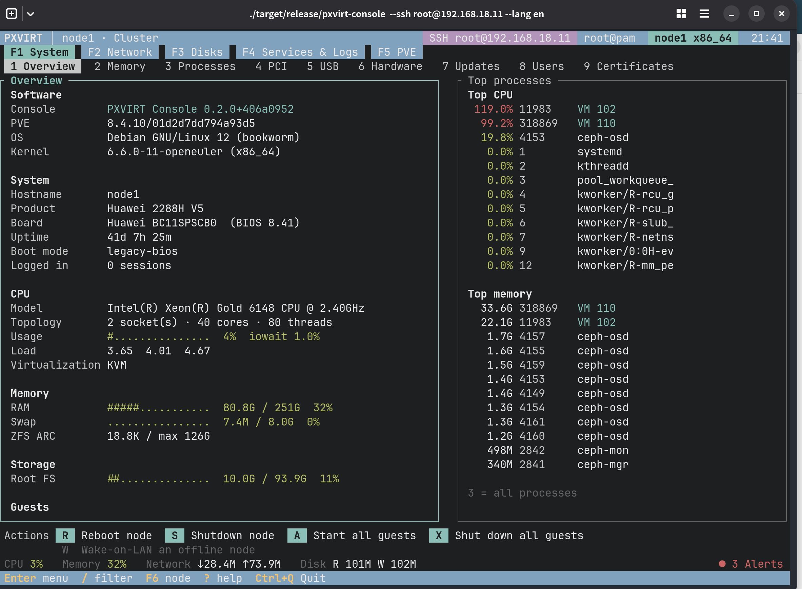
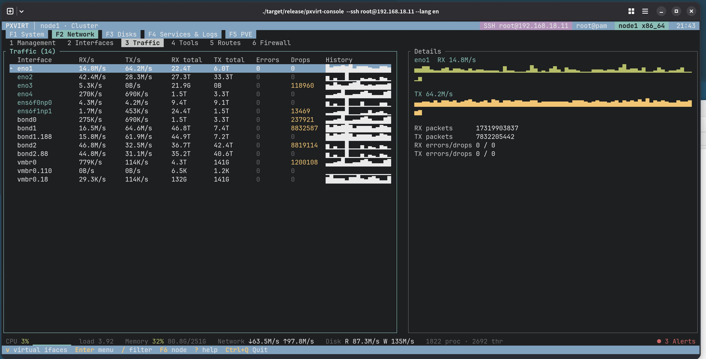
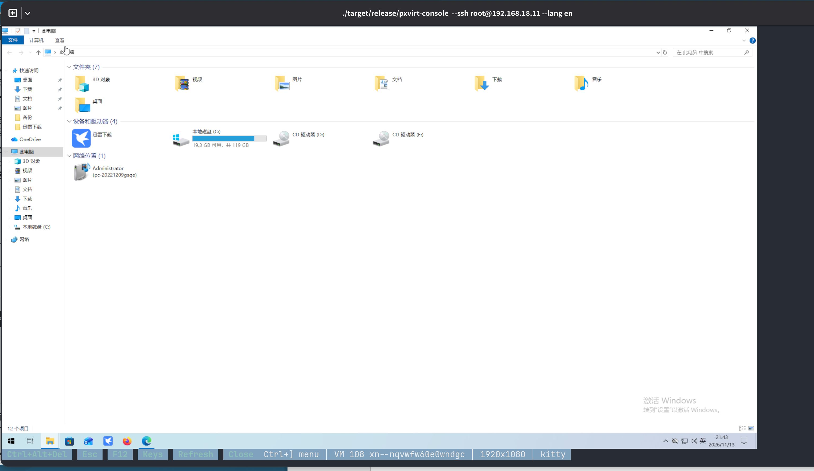

# PXVIRT Console

English | [中文](README.zh-CN.md)

A text-mode node management console for PXVIRT / Proxmox VE, in the spirit of the VMware ESXi DCUI.
It runs on the physical console (tty1) of a node. You can also run it in any terminal on the node, or on
your workstation to manage a remote node over SSH or the PVE API.



## Features

- **System**: overview (software versions, hardware, CPU/memory/storage, top processes), memory (ZFS ARC, swap, hugepages),
  processes, PCI/USB devices (driver bind/unbind, reset, SR-IOV), hardware info, updates, PVE users & ACLs, certificates, power actions
- **Network**: management network (changes are reverted automatically unless confirmed within 60 s), interfaces / bridges / bonds / VLANs,
  live traffic, tools (ping, traceroute, …), routes, firewall
- **Disks**: disks, partitions, LVM, ZFS, Ceph
- **Services & Logs**: systemd services, journal, PVE tasks
- **PVE**: VMs and containers (start/stop/create, full hardware and options editor), storage browser (upload ISOs, templates and OVAs from your computer, or let the node download them from a URL), cluster nodes
- **Graphical VM console**: VNC rendered with SDL2/KMSDRM on tty1, or as Kitty/Sixel/half-block graphics in a terminal, with mouse support
- PVE login (TFA supported) and per-user permissions. Actions the user is not allowed to run are hidden
- Keyboard-first (F1–F5 modules, 1–9 pages, action keys shown in the action bar), mouse supported
- English and Chinese UI (`--lang en|zh`)





## Run modes

| Mode | Command | Notes |
|---|---|---|
| Console | `pxvirt-console.service` on tty1 | Replaces the tty1 login. All features. Cannot be exited, only logged out (also after the idle timeout) |
| Local | `sudo pxvirt-console` | In a terminal on the node. All features |
| SSH | `pxvirt-console --ssh root@node[:port]` | Remote node over one SSH master connection. The API, host commands, shells, VM consoles and live metrics all use it. SSH user `root` logs in as `root@pam` automatically |
| API | `pxvirt-console --remote node[:port]` | PVE API only. You confirm the certificate fingerprint on first connect. Pages that need host commands are hidden |

Quit with **Ctrl+Q** (asks for confirmation; disabled on the system console).
In the graphical VM console, open the menu with **Ctrl+]** in a terminal, or **Ctrl+Alt+Shift+Q** on tty1.

## Recommended terminal

Use [Ghostty](https://ghostty.org) (Linux and macOS). It supports the Kitty graphics protocol and pixel-precise mouse
reporting, so the graphical VM console is sharp and the mouse hits exactly.
Other terminals work too (Kitty, WezTerm, Sixel terminals); otherwise the console falls back to half-block characters.

## Download

Every `v*` tag publishes static Linux binaries (musl, no SDL) for x86_64, aarch64, riscv64 and loongarch64
on the [Releases](https://github.com/jiangcuo/pxvirt-console/releases) page.
They are meant as a client for `--ssh` / `--remote`; the tty1 console with the SDL renderer comes from the Debian package.

macOS builds (arm64 and x86_64, client modes only) are published as zip files. The binary is not notarized;
after unpacking, remove the quarantine flag once:

```bash
xattr -d com.apple.quarantine pxvirt-console
```

## Build

```bash
cargo build --release
```

Static musl build (no SDL), as in CI with the `pxvirt/musl` image:

```bash
cargo build --release --no-default-features --target x86_64-unknown-linux-musl
```

Build dependencies: Rust, `libsdl2-dev`. To build the Debian package:

```bash
make deb
```

Enable the tty1 console after installing the package:

```bash
systemctl enable --now pxvirt-console.service
```

## Configuration

`/etc/pxvirt-console/config.toml`. See [`debian/config.toml.example`](debian/config.toml.example).
For non-root users it is `~/.config/pxvirt-console/`, which also stores known certificate fingerprints.

Design notes: [docs/design.md](docs/design.md)
