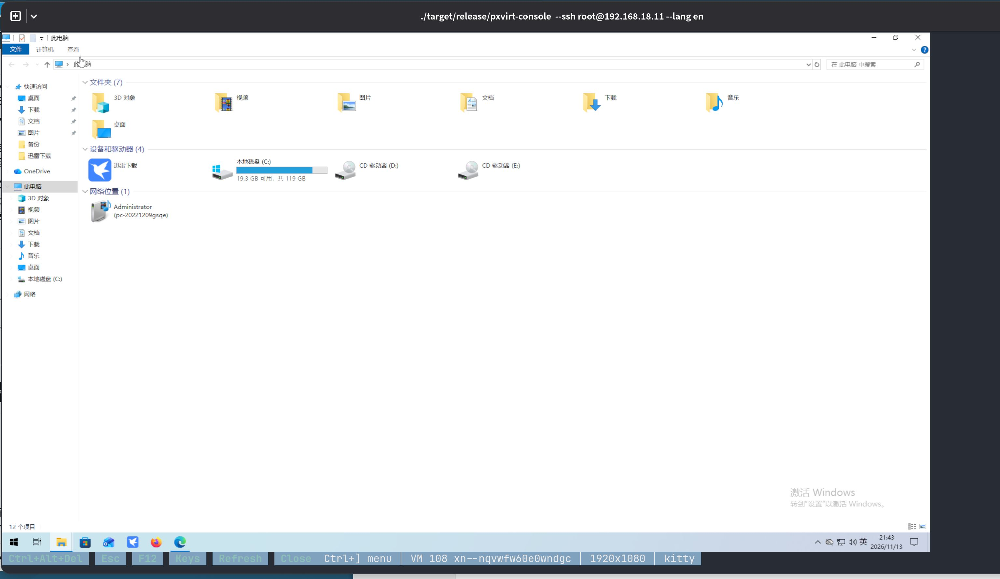

# PXVIRT Console

[English](README.md) | 中文

PXVIRT / Proxmox VE 的文本界面节点管理控制台，类似 VMware ESXi 的 DCUI。
它运行在节点的物理控制台（tty1）上，也可以在节点上的任意终端里运行，或者在自己的电脑上通过 SSH / PVE API 管理远程节点。


## 功能

- **系统**：概览（软件版本、硬件、CPU/内存/存储、进程排行）、内存（ZFS ARC、Swap、大页）、进程、
  PCI/USB 设备（驱动绑定/解绑、重置、SR-IOV）、硬件信息、更新、PVE 用户与权限、证书、电源操作
- **网络**：管理网络（修改后 60 秒内不确认会自动回滚）、网卡/网桥/Bond/VLAN、实时流量、诊断工具（ping、traceroute 等）、路由、防火墙
- **磁盘**：磁盘、分区、LVM、ZFS、Ceph
- **服务日志**：systemd 服务、journal 日志、PVE 任务
- **PVE**：虚拟机和容器（启动、停止、创建，完整的硬件和选项编辑）、存储浏览（从本机上传 ISO、模板和 OVA，或让节点从 URL 下载）、集群节点
- **图形虚拟机控制台**：通过 VNC 连接；tty1 上用 SDL2/KMSDRM 显示，终端里用 Kitty/Sixel/半块字符显示，支持鼠标
- PVE 账号登录（支持 TFA），按用户权限显示功能，没有权限的操作直接隐藏
- 以键盘操作为主（F1–F5 切换模块，1–9 切换页面，操作快捷键统一显示在操作栏），也支持鼠标
- 中英文界面（`--lang en|zh`）




## 运行模式

| 模式 | 用法 | 说明 |
|---|---|---|
| 控制台 | tty1 上的 `pxvirt-console.service` | 替换 tty1 登录界面，功能完整；不能退出，只能注销（空闲超时也会自动注销） |
| 本机 | `sudo pxvirt-console` | 在节点的终端里运行，功能完整 |
| SSH | `pxvirt-console --ssh root@节点[:端口]` | 通过一条 SSH 主连接管理远程节点，API、主机命令、Shell、虚拟机控制台和实时监控都复用这条连接；SSH 用户是 root 时自动以 `root@pam` 登录 |
| API | `pxvirt-console --remote 节点[:端口]` | 只用 PVE API；首次连接需要确认证书指纹；需要主机命令的页面会隐藏 |

按 **Ctrl+Q** 退出（会先确认；在系统控制台上禁用）。
在图形虚拟机控制台里，终端中按 **Ctrl+]** 打开菜单，tty1 上按 **Ctrl+Alt+Shift+Q**。

## 推荐终端

推荐使用 [Ghostty](https://ghostty.org)（支持 Linux 和 macOS）。它支持 Kitty 图形协议和像素级鼠标定位，
图形虚拟机控制台画面清晰，鼠标点得准。其他终端（Kitty、WezTerm、支持 Sixel 的终端）也能用，
不支持图形协议的终端会退回到半块字符显示。

## 下载

每次打 `v*` 标签都会在 [Releases](https://github.com/jiangcuo/pxvirt-console/releases) 发布 x86_64、aarch64、riscv64、loongarch64 的
Linux 静态二进制（musl，不含 SDL），适合作为客户端使用 `--ssh` / `--remote`。tty1 控制台和 SDL 图形显示用 Debian 包。

macOS 版本（arm64 和 x86_64，只支持客户端模式）以 zip 发布。二进制没有经过苹果公证，解压后需要先去掉隔离标记：

```bash
xattr -d com.apple.quarantine pxvirt-console
```

## 构建

```bash
cargo build --release
```

musl 静态构建（不含 SDL），与 CI 一样使用 `pxvirt/musl` 镜像：

```bash
cargo build --release --no-default-features --target x86_64-unknown-linux-musl
```

构建依赖：Rust、`libsdl2-dev`。构建 Debian 包：

```bash
make deb
```

安装软件包后启用 tty1 控制台：

```bash
systemctl enable --now pxvirt-console.service
```

## 配置

配置文件是 `/etc/pxvirt-console/config.toml`，示例见 [`debian/config.toml.example`](debian/config.toml.example)。
非 root 用户的配置在 `~/.config/pxvirt-console/`，已确认的证书指纹也保存在这里。

设计文档：[docs/design.md](docs/design.md)
