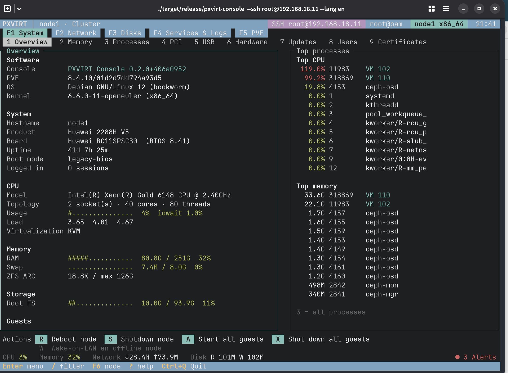
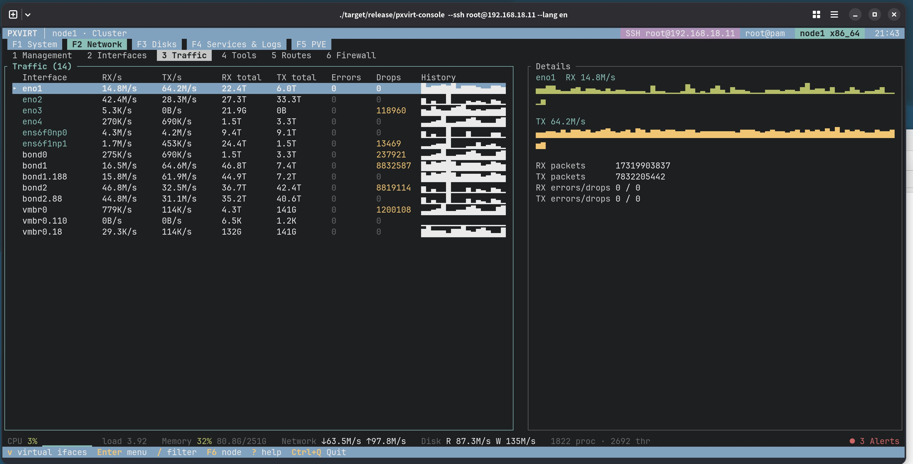

# PXVIRT Console

[English](README.md) | 中文

PXVIRT / Proxmox VE 的文本界面节点管理控制台，类似 VMware ESXi 的 DCUI。
可以运行在节点的物理控制台（tty1）上、节点上的任意终端里，也可以在你自己的电脑上通过 SSH 或 PVE API 管理节点。



## 功能

- **系统**：概览、健康检查和修复（SMART、内核错误、PCIe、ECC、温度、BMC、网卡、RAID、ZFS / Ceph 等）、内存、进程、PCI / USB 直通、硬件信息、BMC（完整事件日志、传感器、BMC 网络）、更新、用户、证书、设置（时区、NTP）、电源
- **网络**：带自动回滚的管理网络、网桥 / Bond / VLAN、实时流量、按进程查看连接并可断开、诊断工具、路由、防火墙
- **磁盘**：SMART、LVM、ZFS、Ceph、所有设备的实时 IO、NFS / iSCSI / FC / NVMe-oF，以及通过厂商工具管理硬件 RAID / HBA / NVMe（StorCLI、PERCCLI、ssacli、arcconf、sas2/3ircu、hiraidadm、Areca、HighPoint、mvcli、tw_cli、nvme-cli）
- **服务日志**：systemd 服务、journal 日志、PVE 任务
- **PVE**：虚拟机实时监控和控制台画面预览、完整的配置编辑、带节点推荐的创建向导、存储上传 / 下载、备份、高可用、复制
- **图形虚拟机控制台**：tty1 上用 SDL2/KMSDRM，终端里用 Kitty / Sixel 图形，支持鼠标
- PVE 账号登录（支持 TFA）并按权限显示功能，键盘和鼠标操作，中英文界面




## 快速上手

```bash
pxvirt-console --ssh root@节点      # 在自己的电脑上管理节点（Releases 里有 Linux / macOS 二进制）
pxvirt-console                      # 在自己的电脑上：从保存的连接中选择
sudo pxvirt-console                 # 直接在节点上运行
```

装了 Debian 包的节点，启用 tty1 控制台：

```bash
systemctl enable --now pxvirt-console.service
```

按 **Ctrl+Q** 退出，按 **?** 查看帮助。推荐终端：[Ghostty](https://ghostty.org)。

## 文档

| | |
|---|---|
| [安装和运行模式](docs/zh/install.md) | 下载、tty1 服务、本机 / SSH / API 模式、配置、构建 |
| [使用方法](docs/zh/usage.md) | 界面布局、按键、鼠标、暂停刷新、权限 |
| [系统](docs/zh/system.md) · [网络](docs/zh/network.md) · [磁盘](docs/zh/disks.md) · [PVE](docs/zh/pve.md) | 各模块的页面说明 |
| [硬件 RAID](docs/zh/raid.md) | 支持的控制器、需要安装的工具、怎么找到工具、定位灯、操作 |

下载：[Releases](https://github.com/jiangcuo/pxvirt-console/releases)（Linux 静态二进制：x86_64、aarch64、riscv64、loongarch64；macOS：arm64 / x86_64）。
